[](https://github.com/BenjaminOddou)
[](https://saythanks.io/to/BenjaminOddou)
[](https://www.python.org/downloads/macos/)
[](https://github.com/pkkid/python-plexapi)

✨ Welcome to the Alfred Plex repository: **An Alfred Workflow** ✨

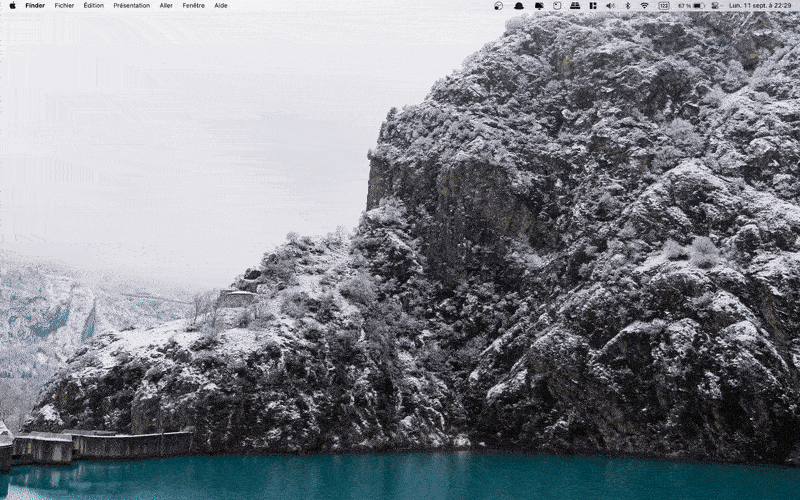

## ✅ Prerequisites

- macOS.
- **Alfred 5.5 or above** (Grid View and Text View) with the [Alfred Powerpack](https://www.alfredapp.com/powerpack/).
- An access to a plex media server.
- **Python 3.10 or above** (required by python-plexapi 4.18). The Python shipped with the Xcode command line tools
  is 3.9: install a recent one with [Homebrew](https://brew.sh) (`brew install python`) or from
  [python.org](https://www.python.org/downloads/macos/). The workflow looks for `python3` in `/opt/homebrew/bin`,
  `/usr/local/bin` then in the system `PATH`, and tells you when the version is too old.

```shell
python3 --version
```

## ⬇️ Installation

1. [Download the workflow](https://github.com/BenjaminOddou/alfred-plex/releases/latest).
2. Double click the `.alfredworkflow` file to install.

Upgrading from 2.x keeps your accounts, servers, presets and aliases (2.x removed them at every update).

## 🏎️ Plex API

This workflow uses [Python-PlexAPI](https://github.com/pkkid/python-plexapi) **4.18.3** and doesn't cover all
capabilities of this tool. If you see a good feature from the Python-PlexAPI that can be incorporated in this
workflow, please let me know by opening an issue or sending a pull request.

## 🧙‍♂️ Invoke the workflow

Launch the menu with `plex` (the keyword can be changed in the
[Workflow Configuration](https://www.alfredapp.com/help/workflows/user-configuration/) panel). **New here?** The menu shows *Sign in with Plex* and *Getting started*: one press on ⏎ and your servers
are added.

The workflow is divided in 6 parts:

1. 🔎 **Plex Search**: type to search your servers; **empty, it lists your libraries** to browse them as a list or
   **as posters**, sorted and filtered by picking. ⏎ on a media opens all its actions.
2. 🧭 **Plex Discover**: search movies, shows and people on Plex Discover (also as posters).
3. 👥 **Plex Accounts**: sign in with Plex, users, devices (clean up old ones), watchlist.
4. 🖥️ **Plex Media Servers**: sessions, recently added, continue watching, libraries, statistics, settings,
   maintenance, activities.
5. 🎛️ **Plex Presets**: saved searches (save one from the last row of Plex Search).
6. 🛟 **Plex Help**: getting started, shortcuts, filters & sorts, alias, cache, logs export.

The menu subtitles show what is configured (servers, accounts, presets).

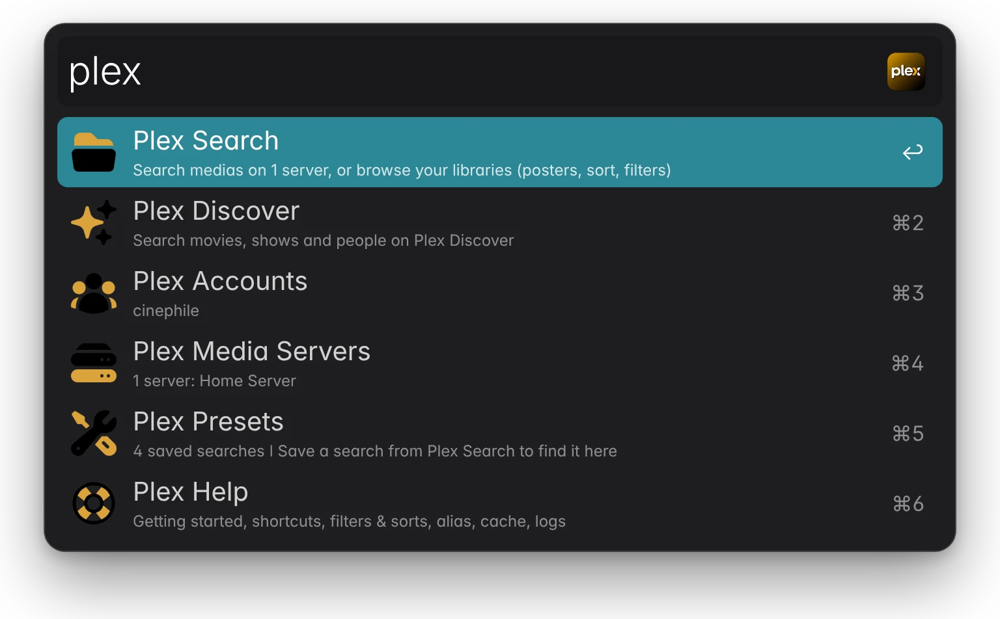

**If you're not the owner of a server, you only see its medias (no management).**

### 🧭 Navigation

- **Every screen has a Return row**, prompts included, and **Return goes back to the screen you came from** (a
  real history: server → account → Return brings you back to the server, with your search query when you came
  from a search). Its subtitle tells where you go. In live searches it's the last row, so ⏎ still opens the
  first result.
- <kbd>⌘</kbd><kbd>⏎</kbd> on **Return** jumps straight back to the main menu.
- **Alfred stays open**: while an action runs (rating, played state, sync, export...), a **⏳ loading page**
  shows what is happening, then the page you were on comes back with a ✅ / 🚨 banner. Long actions (exports,
  downloads, sign in) also send a notification, you can close Alfred meanwhile.
- **Full details** open on top of the current page: <kbd>⎋</kbd> (or <kbd>↩</kbd>) brings you back to it.
- Pages are filtered by Alfred while you type (type `set` in a server page to only see `Settings`).
- After an action (watchlist, preset, alias...) you come back to the page you were on, **with your search
  query**, instead of an empty search.
- Destructive actions (remove an account, a device, clear a folder...) show a **Yes / Cancel** page instead of
  asking you to type `yes`.

## 🤖 Usage of the workflow

### 📚 Libraries (Plex Search, empty): posters, sort and filters without syntax

Open Plex Search without typing: your library sections are listed first (⏎ list, ⌘⏎ posters). Everything is
chosen in lists, nothing to type:

- **↕️ Sort**: every sort of the section (date added, release date, title, rating, duration, last viewed...):
  <kbd>⏎</kbd> natural direction, <kbd>⌘</kbd><kbd>⏎</kbd> the other one. The current one has a ✓.
- **➕ Filter**: genre, year, decade, resolution, collection, actor, studio, content rating... (choose a
  value), or on / off filters such as *Unplayed*, *In progress*, *HDR* (one ⏎). Each active filter has a
  **✖** row to remove it, *Clear all filters* removes them all.
- **🖼️ Posters**: the same selection in Alfred's **Grid View**. The footer of the selected poster shows year,
  duration, rating, content rating, resolution and ✓ played; type to filter the posters by title.
- **🔍 Open in Plex Search** / **💾 Save as a preset**: the selection becomes a regular filter query.

In the Grid View, **a poster does exactly what its row does in the list**: same keys, same shortcuts (⏎, ⌘⏎,
⌥⏎, ⌃⏎, ⇧⏎, fn⏎, ⌘⇧⏎ as configured), the → action, ⇧ / ⌘Y Quick Look. A nested search (seasons of a show,
tracks of an album, medias of an actor...) opens as posters too. Every grid also has the rows of its list:
*🔍 Edit the search*, *💾 Save as a preset*, *☰ List view*, sort and filters for a library. Type in the grid to
filter the posters (title, year, type, server, genres). Posters are available for Plex Search results, Plex
Discover results, your watchlist, recently added, continue watching and the content of any show / collection
(*🖼️ Show as posters* rows). The number of columns is the `🖼️ Poster columns` setting.

Posters are resized by your server (300×450) and cached: they are downloaded once, then also used as icons in
the list views.

### 🖼️ Results view: list, list with posters or grid

Choose how **Plex Search** and **Plex Discover** show their results with the `🔎 Results view` setting
([Workflow Configuration](https://www.alfredapp.com/help/workflows/user-configuration/)):

| Setting | What you get |
| --- | --- |
| **☰ List (no images)** *(default)* | the classic list with type icons: the fastest. |
| **🖼️ List with posters** | the same list, each row shows the poster (Plex Search, Plex Discover, libraries, recently added, continue watching, watchlist). |
| **▦ Grid (posters)** | you search exactly like in the list (live results with posters while you type), the first row **🖼️ Show as posters** (<kbd>⏎</kbd>) shows them in Alfred's Grid View, with the same shortcuts. Empty Plex Search: <kbd>⏎</kbd> on a library opens its posters (<kbd>⌘</kbd><kbd>⏎</kbd> as a list). |

> Alfred's Grid View can't run a search on each keystroke (its script runs once, typing only filters the
> posters already shown). So the search is typed in Plex Search / Plex Discover, and *🔍 Edit the search* in the
> grid brings you back to it with your query.

### 🧹 Poster cache

Posters are kept in **Alfred's cache folder** (`~/Library/Caches/com.runningwithcrayons.Alfred/Workflow
Data/com.benjamino.plex/posters`), with the user avatars. **Plex Help › Workflow Cache & Logs › 🖼️ Posters &
avatars** lists them (type to find one) with their size:

- **🧹 Purge all posters** removes them all (with a confirmation).
- <kbd>⏎</kbd> on a poster removes only this one, <kbd>⌘</kbd><kbd>⏎</kbd> shows it in Finder.
- The media actions page also has **🧹 Remove the cached poster**.

A removed poster is downloaded again the next time it is shown.

### ➡️ Right arrow: an action of your choice

Press <kbd>→</kbd> on a media (Plex Search, Plex Discover, libraries, recently added, posters...): Alfred shows its
actions panel for the media title (`The Matrix (1999) · Home Server`). Type `plex` (or pick **Plex**, Alfred puts it
first once you used it) and <kbd>↩</kbd>: the action chosen in the `➡️ Right arrow` setting runs:

| Setting | Action |
| --- | --- |
| **📖 Full details** *(default)* | the media sheet (Text View): poster, summary, ratings, cast, crew, files. <kbd>⎋</kbd> or <kbd>↩</kbd> goes back to your results. |
| **🔎 More details** | the same as a list: summary, cast (⏎ their medias), crew, files, ids... **Return** goes back. |
| **⚙️ Media actions page** | play, mark played, rate, playlists, collections, download... |
| **▶️ Play** | streams with your media player (Plex Discover: More details). |
| **🌐 Open in Plex Web** | app.plex.tv. |

> Alfred always opens its actions panel on <kbd>→</kbd> (Universal Actions): a workflow can't skip it, hence
> the <kbd>↩</kbd> on **Plex**. The other actions of the panel (Copy, Large Type...) use the title.
> <kbd>←</kbd> closes the panel. *Plex* on any other text in Alfred searches it in Plex Search. The media actions
> page also has a *🔎 More details* row.

### 📖 Full details sheet

From the media actions page (*📖 Full details*) or <kbd>⌥</kbd><kbd>⏎</kbd> on a poster, Alfred's **Text View**
shows a Markdown sheet: poster, tagline, release date, duration, content rating, studio, ratings with their
source (Rotten Tomatoes, IMDb, TMDB), your rating, played state, summary, **cast with characters**, directors /
writers / producers, genres, countries, collections, labels, edition, library, TMDB / IMDb / TVDB ids and every
file with its video, audio and subtitle streams.

### Plex Search: search medias throughout your servers

Servers are searched **in parallel**, so adding servers doesn't make the search slower.

#### 1. Simple search

Type your request. You can optionally add a `/` followed by one of the following media types: _track, album,
artist, collection, actor, director, genre, movie, photo, photoalbum, playlist, show, episode, clip_.
Titles containing a `/` (`AC/DC`) are searched as is.

Link to the [Python-PlexAPI documentation](https://python-plexapi.readthedocs.io/en/latest/modules/server.html#plexapi.server.PlexServer.search).

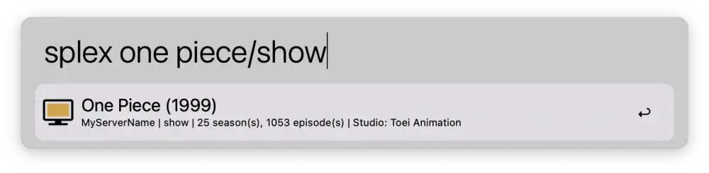

#### 2. Advanced search

Search your library sections with `filters` and/or `advanced filters` separated by `/`. A `/` only starts a
new filter when it's followed by `name=`, so values may contain `/`. Only the sections that can answer the
`libtype` are queried.

Link to the [Python-PlexAPI documentation](https://python-plexapi.readthedocs.io/en/latest/modules/library.html#plexapi.library.LibrarySection.search).

The following example `libtype=movie/decade=1980/country=france` returns `movies` released between `1980` and
`1990` in the country `France`.

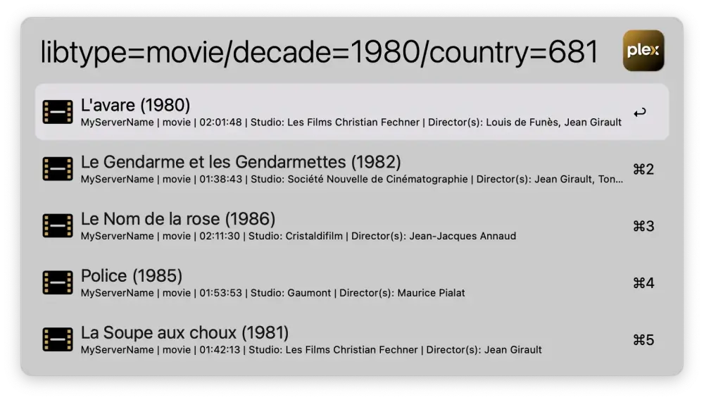

Workflow specific filters:

| Filter | Alias | Example | Description |
| --- | --- | --- | --- |
| `server` | `sv` | `sv=home,nas` | only search these servers |
| `section` | `sc` | `sc=movies` | only search these library sections |
| `watchlist` | `wa` | `wa=1` | only medias on (`1`) / not on (`0`) your watchlist |

When the search is empty, the `👀 Default view` of the configuration is displayed (python dict or JSON, for
example `{"sort": "addedAt:desc"}`).

The last row, **💾 Save this search as a preset**, keeps the current query in Plex Presets.

#### 3. Actions on medias

> Every shortcut can be changed (or disabled) in the user configuration panel. **Plex Help › Keyboard
> Shortcuts** lists your current ones.

| Default | Action | Medias |
| --- | --- | --- |
| <kbd>⏎</kbd> | Nested search, otherwise the **media actions page** | all |
| <kbd>fn</kbd><kbd>⏎</kbd> | Media actions page | all but actors / genres |
| <kbd>⌘</kbd><kbd>⏎</kbd> | Open on app.plex.tv | all but genres / photos |
| <kbd>⌥</kbd><kbd>⏎</kbd> | Stream with VLC / IINA / INFUSE | movie, episode, clip, track, album |
| <kbd>⌃</kbd><kbd>⏎</kbd> | Movie and TV Show Search | movie, show |
| <kbd>⇧</kbd><kbd>⏎</kbd> | Add / remove watchlist | movie, show |
| <kbd>⌘</kbd><kbd>⇧</kbd><kbd>⏎</kbd> | Mark played / unplayed (✓ shown in the subtitle) | movie, show, season, episode, clip |
| disabled | Download the file(s) | movie, episode, clip, track, album, season |

The **media actions page** gathers everything in one place: play, browse children (seasons, episodes,
tracks...), go to the show / season / album, open on the web, mark played / unplayed, ⭐ rate (0-10), watchlist,
Movie and TV Show Search, ➕ playlists and 🗂️ collections (**the ones the media is in come first**, ⏎ removes it
from them, then the others, ⏎ adds it, or create a new one), 📄 file(s)
details (size, container, resolution, codecs, bitrate; ⏎ shows the file in Finder when it's on this Mac or copies
its path, ⌘⏎ copies the direct stream link), ⬇️ download, 🔄 refresh metadata, 🔍 analyze, ℹ️ infos (⌘L for the
summary) and 🗑️ delete from the server (needs *Allow media deletion* in the server settings). **Return** brings you
back to your search results.

Details:

1. **Nested search**: on _actor, director, collection, artist, album, genre, show, season_.
2. **Open on the web** (<kbd>⌘</kbd><kbd>⏎</kbd>): open the media on app.plex.tv. Not available for _genre_.
3. **Stream** (<kbd>⌥</kbd><kbd>⏎</kbd>) with VLC / IINA / INFUSE: _movie, episode, clip, track\*, album\*_. If
   you have multiple versions of a _movie, episode, clip_, you choose the file to play (video, audio, subtitles
   and size are displayed). \*INFUSE doesn't accept standalone audio streams.
4. **Media infos** (<kbd>⌃</kbd><kbd>⏎</kbd>) with the [Movie and TV Show Search](https://github.com/tmcknight/Movie-and-TV-Show-Search-Alfred-Workflow)
   workflow by [Tom McKnight](https://github.com/tmcknight) (2.16.0 or above): _movie, show_.
5. **Watchlist** (<kbd>⇧</kbd><kbd>⏎</kbd>): add or remove a _movie_ or _show_ from your plex watchlist.
6. **Poster preview**: press <kbd>⇧</kbd> (tap) or <kbd>⌘</kbd><kbd>Y</kbd> to Quick Look the poster.
7. **Copy**: <kbd>⌘</kbd><kbd>C</kbd> copies the title.

#### 4. VLC, IINA and INFUSE integration

If you don't have VLC / IINA on your mac, install it with homebrew:

```shell
brew install --cask vlc
brew install --cask iina
```

The workflow uses their command line tools (`vlc` / `iina`), found in `/opt/homebrew/bin` or `/usr/local/bin`.
Check them with:

```shell
which vlc
which iina
```

If they are not found, reinstall the application with homebrew. INFUSE doesn't need a command line tool, install
the application from the App Store.

Links: VLC [homebrew formulae](https://formulae.brew.sh/cask/vlc), IINA [homebrew formulae](https://formulae.brew.sh/cask/iina),
INFUSE [website](https://firecore.com/infuse).

### Plex Discover: search medias using discover

Search movies, shows and people on [Plex Discover](https://support.plex.tv/articles/discover/) (add `/movie`,
`/show` or `/people` to filter). You can perform the same actions listed [above](#3-actions-on-medias), except
streaming. The nested search looks for the media on your servers, and **Return** brings you back to your
Discover results. With an empty query, the most watchlisted medias are displayed, with **🖼️ Show as posters**
on top. In the Discover Grid View, the shortcuts are the same as in the list (⏎ find it on your servers,
⌘⏎ web, ⌃⏎ infos, ⇧⏎ watchlist).

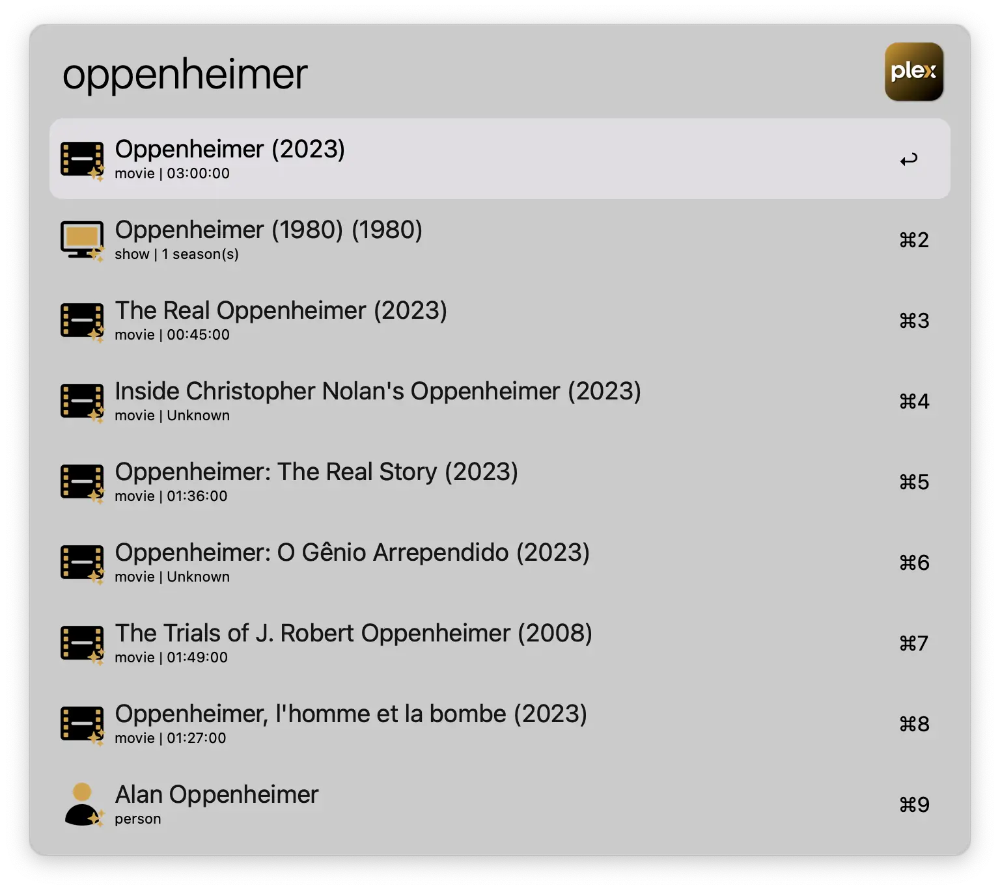

### Plex Accounts: manage your plex accounts

Connect one or more accounts with **Sign in with Plex**: your browser opens `app.plex.tv`, sign in the way you
like (password, 2FA, Google, Apple...). Nothing is typed in Alfred. You have 3 minutes to complete the sign in.
The servers of the account are added automatically (connections are tested in parallel) and a notification tells
you when it's done.

> Since 3.0, sign in is OAuth only: the username / password and token methods are gone.

In this section you can:

- **Sync** the account (refresh its data and reconnect its servers).
- See the list of your servers. Servers that aren't added to the workflow are greyed out: press <kbd>⏎</kbd>
  to sync them.
- See your friends and connected users **with their avatar** (and export them to CSV). Avatars are also shown on
  your connected accounts and on the server sessions. They stay in the Alfred cache with the posters (no download
  to your folders).
- Manage devices, sorted by last activity (`Last seen 3 days ago`):
  - **Clean up old devices**: removes in one go the devices not seen for 90+ days (`🧹 Old devices` setting).
    Servers and this workflow are never removed.
  - <kbd>⏎</kbd> details (product, version, activity, IP location, Google Maps), <kbd>⌘</kbd><kbd>⏎</kbd> remove.
  - Export to CSV.
- Manage your watchlist: <kbd>⏎</kbd> finds the media on your servers, <kbd>⌘</kbd><kbd>⏎</kbd> removes it,
  export to CSV.

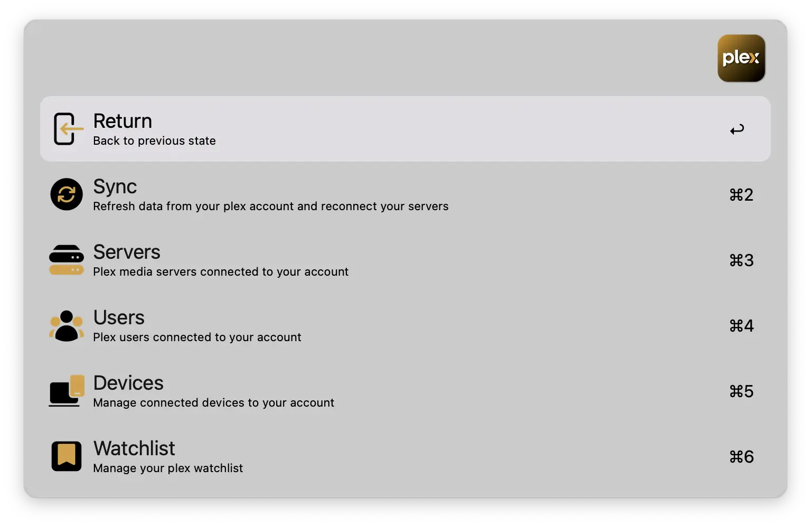

> Removing a plex account removes all its servers. You can also remove a server in the Plex Media Servers section.

When connected, the workflow appears in the `Authorized Devices` section of plex
([documentation](https://support.plex.tv/articles/115007577087-devices/)). Removing this device from the
workflow also disconnects the account.


### Plex Media Servers: manage servers and perform actions

Select a server:

- **Update**: download the last version, or <kbd>⌘</kbd><kbd>⏎</kbd> to let a Mac / Windows server install it.
- **Sessions** (refreshed every 5 seconds): user, player, progress, Direct Play / Transcode, bandwidth, LAN / WAN.
  <kbd>⏎</kbd> media actions, <kbd>⌘</kbd><kbd>⏎</kbd> terminate with a message, <kbd>⌥</kbd><kbd>⏎</kbd> device
  details, *Terminate all* when several streams play, export to CSV.
- **Recently Added** and **Continue Watching**: media rows with all the shortcuts above.
- **Library Sections**: scan, refresh, analyze, empty trash, history, recently added, *Search in this section*,
  size and duration, **export the whole section to CSV** (title, year, file path, size, resolution, codecs,
  views, ratings, TMDB / IMDB ids...).
- **Statistics**:
  - *Live*: bandwidth, CPU and RAM (with bars), refreshed every second.
  - *Libraries*: items, size and duration per section, share of the storage.
  - *Plays*: plays per day, busiest day, peak hour, top users, titles, libraries, devices and platforms.
  - *Bandwidth*: local / remote traffic, per user, per device and per day.
  - *Media Quality*: 4K / 1080p / 720p / SD / HDR per section.
  - Every statistic can be exported to CSV.
- **Settings**: display, modify and export to CSV. Values are typed naturally: `true` / `false` (or `yes` / `no`,
  `1` / `0`) for booleans, numbers for `int` / `double` and plain text for `text` (quotes are optional).
- **Maintenance**: download logs, download databases, empty trash, clean bundles, optimize database, run any
  scheduled task (backup, cleanups...).
- **Activities**: what the server is doing right now (scans, analysis...) with progress bars.

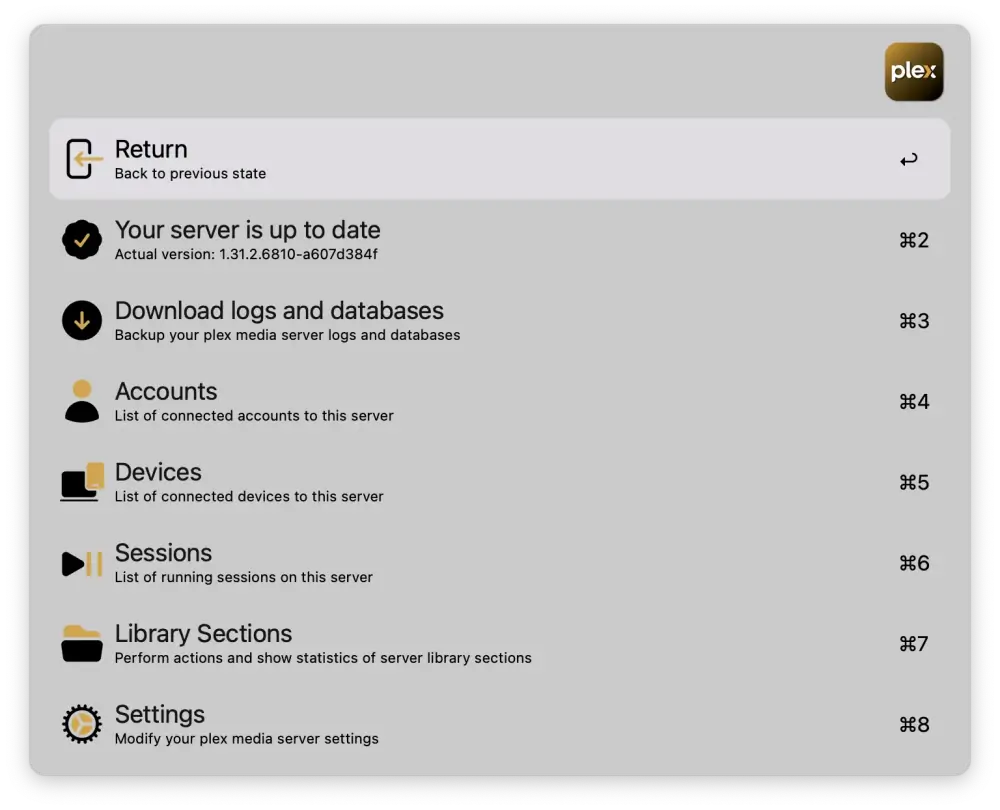

### 📤 Exports

CSV files are written in the `📁 Downloads & exports` folder (named `plex-<server>-<kind>-<date>.csv`, UTF-8 for
Numbers / Excel) and shown in Finder:

| From | Export |
| --- | --- |
| Library section | every movie / episode / track with file, size, quality, views, ratings, ids |
| History, Statistics › Plays | every play (date, user, device, platform, library, title) |
| Statistics | libraries, bandwidth, media quality |
| Sessions, Settings | running sessions, every setting |
| Account | devices, users, watchlist |
| Presets | your presets |
| Plex Help › Workflow Cache & Logs | **workflow logs** (zip with versions) to attach to a GitHub issue |

### Plex Presets: manage presets to rapidly search medias

#### 1. Create a preset

- From Plex Search: the last row, **💾 Save this search as a preset**, asks only for a `title` (and an optional
  `/subtitle`).
- Or press <kbd>⏎</kbd> on `Add a new preset`, input a `value` (filters with long names or aliases), then a
  `title` and an optional `subtitle` separated by a `/`.

#### 2. Use and organize presets

| Key | Action |
| --- | --- |
| <kbd>⏎</kbd> | open Plex Search with the preset |
| <kbd>⌘</kbd><kbd>⏎</kbd> | edit page: title/subtitle, value (<kbd>⌘</kbd><kbd>C</kbd> copies it), duplicate, move up / down, delete |
| <kbd>⌥</kbd><kbd>⏎</kbd> | delete (with confirmation) |
| <kbd>⌃</kbd><kbd>⏎</kbd> | duplicate |
| <kbd>⇧</kbd><kbd>⏎</kbd> | move up |

Presets with unknown filters are flagged with ⚠️. The list can be exported to CSV.

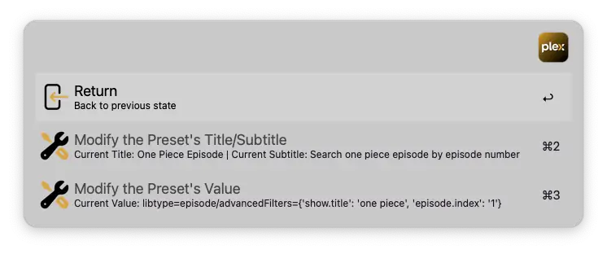

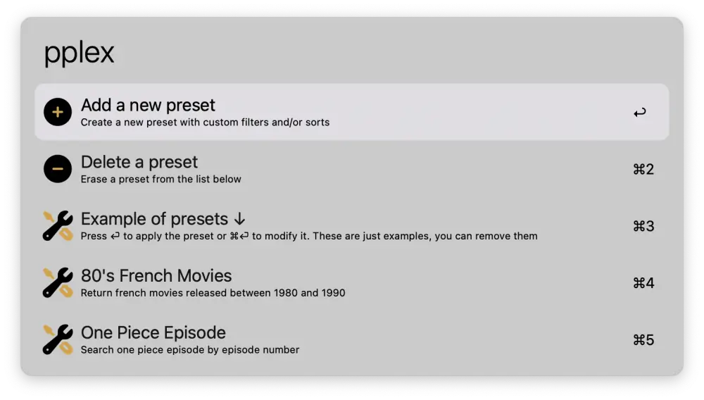

### Plex Help: workflow configuration + filter & sort options

**Getting Started** (for new users), **Keyboard Shortcuts** (your current shortcuts and keywords), workflow
cache (with the `plex.log` file and **Export Workflow Logs**), data and filter alias.

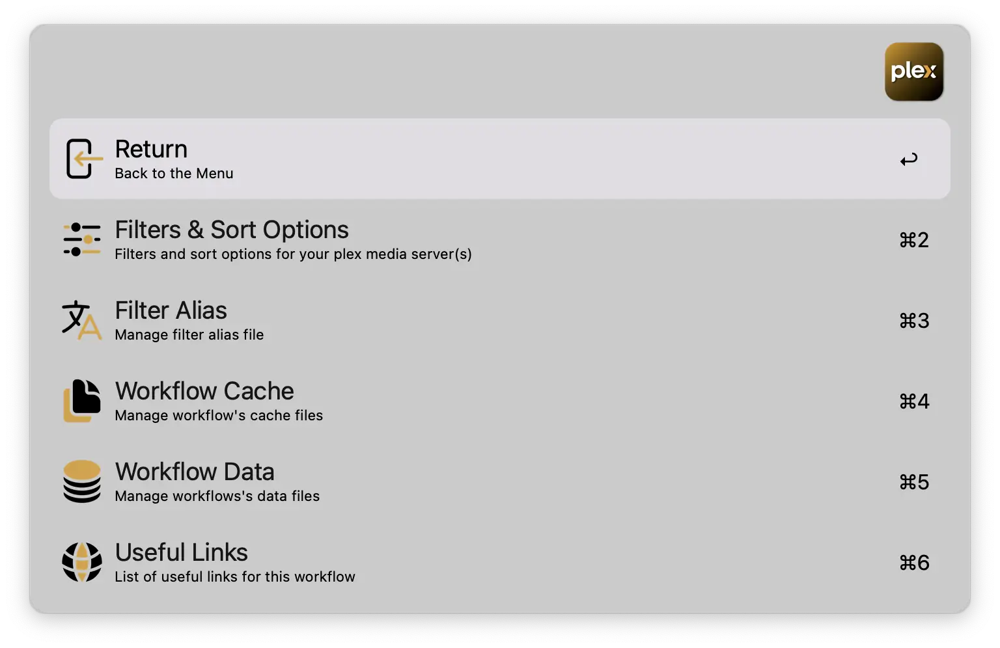

Filters, fields and sorts options are generated from the library sections of **all** your servers. They vary
with your medias and agents.

#### 1. Filters

> Filters can be aliased, see section `4. Alias` below

Plex filters are applied by typing `filterName=value`. Use `/` to separate them. Find the list of filters under
each library section of your servers.

Example: `libtype=movie/actor=adam driver`. It returns `movies` with `Adam Driver`.

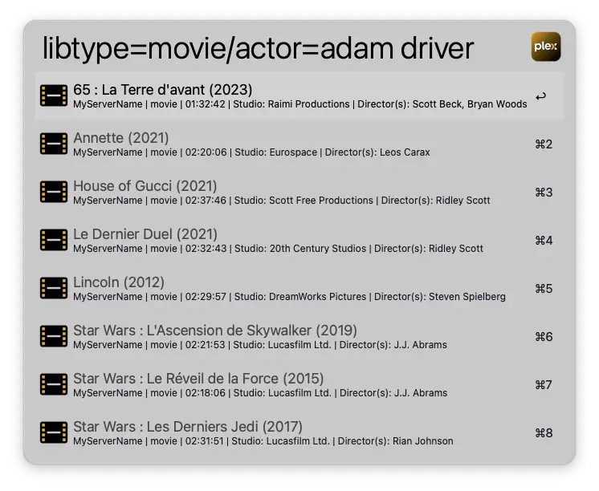

#### 2. Fields (advanced filters)

Plex fields (or advanced filters) are applied by typing `advancedFilters={<FILTER>}` (or `af={<FILTER>}`):

- Use `/` to separate advanced filters from other filters.
- Use them along with a `libtype`.
- Provide a valid Python _dict_ or _JSON_. Double quotes `"` and single quotes `'` are valid. The value is
  parsed, never executed.

To know more on how to use these filters, check the [Python-PlexAPI documentation](https://python-plexapi.readthedocs.io/en/latest/modules/library.html#plexapi.library.LibrarySection.search).

Example: `libtype=episode/advancedFilters={'show.title': 'one piece', 'episode.index': '1074'}`. It returns
`episodes` where `episode number` is `1074` and the title of the show contains `one piece`.


#### 3. Sorts

Sort results by typing `sort=sortName:dir` (or `so=sortName:dir`). Direction can be `:asc` or `:desc`.

Example: `libtype=movie/sort=originallyAvailableAt:desc` displays `movies` from the `most recent` to the `oldest`.

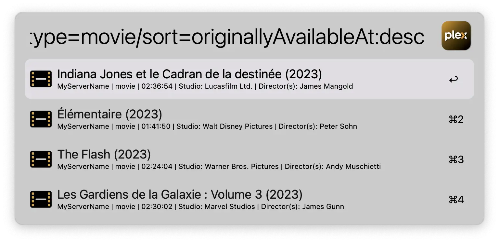

#### 4. Alias

Aliases let you write filters faster: `libtype` becomes `lt`, `studio` becomes `st`... **Aliases and long names
are always accepted**; the `📜 Use alias` option only changes what the workflow displays.

Press <kbd>⏎</kbd> on a filter to change its alias. The `alias.json` file is located in the `📁 Data folder`
(`~/Library/Application Support/Alfred/Workflow Data/com.benjamino.plex` by default). New filters shipped with an
update are added to your file automatically, your custom aliases are kept.

Example: `af={'addedAt>>': '30d'}/lt=show`. It returns `shows` added or containing new elements (seasons,
episodes) during the last `30 days`.

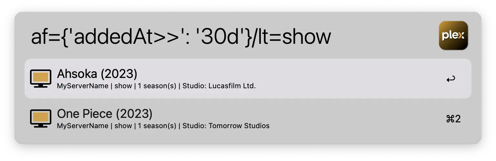

## 🧩 How it works

### Workflow diagram

The diagram is a small hub. Every row of the workflow sets `{var:action}` and the
**Router** sends it to the right place:

```
Plex (keyword)  ──┐
Plex Search     ──┤
Plex Discover   ──┤
Grid View       ──┼──▶ Router {var:action} ──▶ browse · search · discover · grid · ask · open · reveal · mtv
dispatch        ──┘            │              └▶ details ──▶ Text View (media sheet)
   ▲                           └──▶ run ──▶ Run Script (main.py run) ──▶ dispatch (next step)
   └────────────────────────────────────────────────────────────────────────┘
grid ──▶ Run Script (main.py grid) ──▶ Grid View (posters) ──▶ Router
ask  ──▶ Plex Prompt (Script Filter with a Return row) ──▶ Router
run  ──▶ Run Script  +  loading page (Alfred stays open until the result)
```

| Variable | Role |
| --- | --- |
| `action` | `browse`, `search`, `discover`, `grid`, `ask`, `run`, `details`, `open`, `reveal`, `mtv` (or `done`) |
| `nav` | page path, e.g. `servers/<machineId>/settings/general` |
| `cmd` / `payload` | background command and its JSON parameters |
| `prompt_title` / `prompt_subtitle` | text of the prompt (`ask`) |
| `back` | history: JSON stack of the screens you came from (Return pops it) |
| `confirm` | Yes / Cancel page content |
| `run_id` / `loading_label` | status file and text of the loading page |
| `state` | sort and filters of the library browser |
| `details_file` | Markdown sheet shown by the Text View |

A command (`python3 main.py run`) decides the next step (show a page, ask another question...) by printing
Alfred variables, which go back to the Router through the `dispatch` trigger.

### Code

```
src/
├── main.py                 # entry point (checks Python version)
├── alfred_plex/
│   ├── cli.py              # browse | search | discover | run
│   ├── alfred.py           # Item / Feedback / Intent (actions as Alfred variables)
│   ├── nav.py              # page paths + router
│   ├── settings.py         # user configuration
│   ├── store.py            # accounts / servers / presets / alias JSON files
│   ├── plex.py             # python-plexapi: config, connections, caches
│   ├── context.py          # per run context
│   ├── filters.py          # search query parser
│   ├── media.py            # plex medias → Alfred rows
│   ├── system.py           # notifications, logs
│   ├── stats.py            # plays, bandwidth, libraries, quality (pure functions)
│   ├── export.py           # CSV exports + logs archive
│   ├── library.py          # library browser state (sort, filters)
│   ├── posters.py          # posters cache for the Grid View
│   ├── details.py          # Markdown media sheet for the Text View
│   ├── views/              # pages (menu, library, grid, accounts, servers, stats, media, presets, help, search, discover)
│   └── commands/           # background actions
├── lib/                    # python-plexapi 4.18.3 + dependencies (pure python)
├── notificator             # vitorgalvao/notificator (latest)
└── info.plist
```

## 🧪 Development

```shell
# run the tests (no network needed: plexapi parses real Plex XML from a fake HTTP session)
python3 -m pip install pytest ruff
python3 -m pytest
python3 -m ruff check src/alfred_plex src/main.py tests

# update the bundled dependencies
cd src && ./update.sh
```

Try a page from a terminal (from the `src` folder):

```shell
nav=help python3 main.py browse | python3 -m json.tool
```

## ⚖️ License

[MIT License](LICENSE) © Benjamin Oddou
